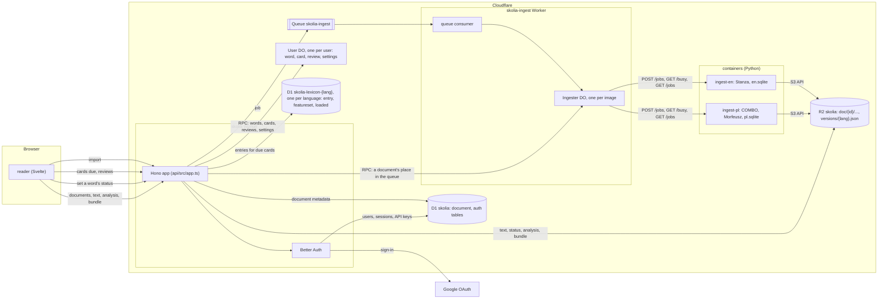
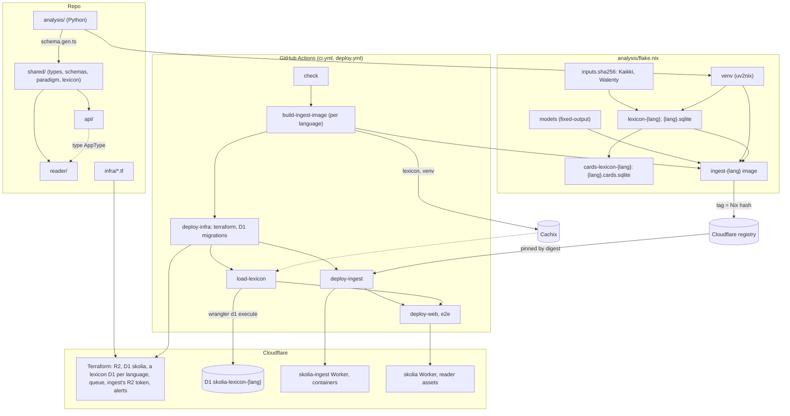

# skolia architecture

An assisted-reading app built around morphology. Tap a word or select a span. You get the lemma, the full grammatical features, the paradigm with the current form highlighted, and why the word has that form. Polish first, kept behind a language-plugin interface.

## Principles

- **Analyze once, at import.** Taps are local lookups: instant and offline. Only translations and explanations need the network.
- **UD features are the internal schema** (`Case=Gen|Number=Sing|Gender=Masc|Animacy=Anim`). Only plugins know which language they handle.
- **Track knowledge per lemma.** Known words and cards key on `(lang, lemma, upos)`, not on surface forms.
- **Keep the readings the analyzer didn't pick.** Show alternatives and let user corrections override them.
- **The LLM explains; it doesn't analyze.** It gets the sentence plus the parsed features. Its responses are cached and shared across users.
- **The source text is permanent, analysis can be thrown away, and user data points at the text** (character offsets).

## Components



- **Open a document:** D1 has its metadata and R2's `status.json` the names of its current analysis and bundle, which the reader then fetches from R2 through the API, as stored. Browsers cache them by HTTP (`no-cache` with the blob's key as its ETag), asking before each use, so the API checks the viewer may still see the text and answers 304 without reading R2; there's no IndexedDB yet.
- **Tap a word:** local, from the bundle already loaded (`shared/lexicon`, `shared/paradigm`). Setting a word's status goes to the User DO.
- **Review:** the User DO gives the due cards and the API adds their entries from its language's lexicon D1. The DO never reads the lexicon, and the reader's word sheet never reads the lexicon D1s, so the two can show different lexicon versions until a document is re-bundled.
- **Import:** the API puts the text in R2, the metadata in D1, a queued `status.json` and the job on the queue. The consumer hands it to the Ingester named after its language's image, so a deploy that changes an image starts a new container. While it waits, the importer's summary says where it is: the API asks the language's Ingester (a Durable Object binding to the ingest Worker), which asks a running container for its jobs (`GET /jobs`) and never starts one.
- The ingest Worker has no R2 or D1 binding: containers reach R2 over its S3 API, with a token Terraform makes.
- Lexicon lookups only see the rows of each language's version in `loaded`.

Locally, `wrangler dev` runs both Workers and the ingest containers, with local D1, R2 and Queue. The API reaches them through small interfaces (`api/src/ports.ts`, faked in the tests); ingest reaches R2 over its S3 API, which wrangler dev also serves for the local bucket. Ingest writes `doc/{doc}/status.json` as it goes (analysing, ready, failed), the API writes queued whenever it queues a document, and the API reads it to tell the reader.

On Cloudflare: Terraform (`infra/`) manages what wrangler doesn't: R2, D1, the queue, ingest's R2 token and billing alerts. Both Workers are deployed with wrangler: `skolia` with the reader as static assets on workers.dev and skolia.io (`api/wrangler.jsonc`), and `skolia-ingest` with its containers, one per language (`api/wrangler.ingest.jsonc`). Wrangler also applies their Durable Object migrations, which the Terraform provider can't do on an update (it resends the first migration and Cloudflare refuses it). The consumer hands each job to its language's container over HTTP and acks it once accepted: a consumer may run 15 minutes and an analysis can take longer. The container keeps jobs in memory, sleeps when idle (the Durable Object asks ingest whether it's busy before stopping it), and has the models and lexicon in its image. A job lost with its container is re-queued by the stuck rule below.



- D1 is bound by name. If Terraform hasn't made a database, `wrangler deploy` creates one outside Terraform, so `deploy-infra` goes first.
- The ingest image has `lexicon-{lang}` but not the cards lexicon. The cards lexicon is built from the lexicon, with Morfeusz's paradigms for Polish.
- `load-lexicon` only substitutes from Cachix and never fetches the inputs, so it needs the lexicon there; `build-ingest-image` pushes it only when an image is rebuilt.
- `deploy-web` waits for `load-lexicon` and `deploy-ingest`: the end-to-end tests read the lexicon.
- `schema.gen.ts` is generated from analysis; the blob keys in `shared/keys.ts` are kept in step by hand.
- A preview loads each language's entries for wordfreq's 3,000 most common words only, and accepts 20 imports a day.

| Part | Tech | Responsibility |
|---|---|---|
| Client | PWA, Svelte 5 + TypeScript; one layout for phone (bottom sheet) and desktop (side panel) | Reader, word/span sheet, paradigm tables, review sessions (online for now) |
| API | Cloudflare Workers (TypeScript) | Auth, import job submission, cards and reviews, quotas; later the explain proxy and cache |
| User data | D1, a Durable Object per user | D1: users, document metadata. Durable Object: words, cards, reviews (FSRS) |
| Lexicon | D1, one per language (`skolia-lexicon-{lang}`) | For flashcards, by lemma id: senses, relations, pronunciations and paradigms, with the feature sets they point into; built from the same lexicon as the ingest images |
| Blobs | R2 | Source texts, analysis blobs, bundles |
| Analysis | Python on Cloudflare Containers, fed from Cloudflare Queues by a consumer Worker | Segment, analyze, match lexicon, write blob |
| Lexicon build | Offline Python scripts | Kaikki/Wiktionary + Morfeusz → per-language lexicon files |

## Frontend / backend split

The backend does anything heavy, anything that happens once, and anything secret. The frontend does anything that has to feel instant.

```
Import:       phone → API → queue → analysis container    (slow, once per text)
Open:         phone ← document + its lexicon bundle        (one request, then cached)
Tap/select:   phone only                                   (structure, paradigm, gloss)
Translate/why: phone → API → cache or LLM                  (network, metered)
Mark/review:  phone → API → user's Durable Object         (online; offline later)
```

## Language plugin

Everything language-specific lives in `analysis/src/skolia_analysis/lang/<lang>/`. Code outside it reaches a language only through `plugin.py`, and `lang/__init__.py` lists the languages:

```python
class LanguagePlugin:
    LANG: str                                    # "pl"
    MODELS, DEFAULT_MODEL, DEFAULT_SNAP          # parsers by name, reconcile policy
    def parser(model) -> Parser
    def analyzer(parser, options, data) -> Analyzer   # text -> blob; its name versions the blob
    def lexicon_source() -> LexiconSource        # Kaikki entries in the analyser's terms
    def bundler(lexicon, data) -> Bundler        # blob -> bundle: senses, paradigms, frames
```

`data` is the language's data directory: the lexicon (`{lang}.sqlite`) and whatever else the plugin builds (Polish: `pl-valency.json`).

Polish: COMBO (XLM-RoBERTa, trained on UD Polish PDB) picks the reading that fits the context and gives the dependency parse; Stanza models are available as alternatives. Morfeusz 2 supplies the list of candidate readings and generates missing paradigms. When the parser's reading isn't one Morfeusz allows, the closest Morfeusz reading replaces it and the parser's is kept alongside. Measured choices and scores: `analysis/EVALUATION.md`.

Why a word has its case is worked out at import (`analysis/src/skolia_analysis/lang/pl/cases.py`) from the dependency tree and the verb's valency in Walenty (IPI PAN's valency dictionary, CC BY-SA 4.0): each token with a case gets a `case_reason` (the rule, the word that causes it, and the verb or preposition). Rules: preposition, agreement, coordination, governing numeral, verb's lexical case (`szukać` + gen), negation (`nie mam czasu`), structural object, partitive, subject, predicate after `być`, possessive and noun complement, verbal noun's object, instrumental, vocative. The reader turns the reason into a sentence and underlines the triggering word.

English: Stanza (`default_accurate`, trained on UD English treebanks including EWT) gives the reading and parse on its own. There's no candidate list, case reasons or valency.

French: the same, with Stanza's French `default_accurate` (CamemBERT, trained on UD French treebanks including GSD).

## Lexicon (static, per language)

Built offline (`analysis/src/skolia_analysis/lexicon/`) into one SQLite file per language on the server, keyed by the analyser's `lemma_id`. The lexicon follows the analyser's conventions: each Kaikki (Wiktionary) headword is looked up in Morfeusz and converted with the analyser's own code, so `który` is filed as DET just as the analyser tags it.

English and French have no Morfeusz: headwords are filed under Kaikki's part of speech mapped to UPOS, and Wiktionary's inflection table gives the paradigm.

```
entry(lemma_id, lemma, upos, senses_json, relations_json, paradigms_json)
  senses:    gloss, tags (slang, dated...), examples, and `when`: the features that select
             the sense (pies the dog: Animacy=Nhum; the cop: Animacy=Hum)
  relations: aspect partner (robić <-> zrobić), derived-from (pani <- pan, rubelek <- rubel)
  paradigms: forms with UD features, for languages without a generator (English, French); empty for Polish
```

Polish paradigms aren't stored: Morfeusz generates them, in the analyser's feature conventions, when a document's bundle is made. A verb's paradigm includes its participles and gerunds. English paradigms are stored in UD EWT's conventions: a form lists every feature set it serves (`walk` is the infinitive, the imperative and the present for every person but the third singular), since the reader matches a token to the forms whose features include the token's. French paradigms are stored in UD French GSD's conventions (an imperfect is `Tense=Imp`, a conditional `Mood=Cnd`); Wiktionary gives only the masculine singular past participle, so its feminine and plural forms follow the regular rule (`pris`, `prise`, `prises`), with the few that never agree (`été`) left alone.

Each imported document gets a bundle with only the lemmas it uses (meanings, relations, paradigms), so taps stay offline. Lookup falls back from the exact `lemma_id` to the lemma lowercased under the same part of speech (*Old* Town is the adjective *old*), then to the same lemma under another part of speech (English *be* as AUX is Wiktionary's verb), then to the lemma lowercased under any. The reader marks the token's form in the paradigm by its text and features, counting only features the paradigm's forms have. A full-dictionary download for search is a possible later addition (meanings only, without paradigms).

Later: showing a word's frames on its sheet ("`pomagać` + dative", from the same Walenty data the case reasons use) and `expression` (multi-word, matched by lemma sequence, from Wiktionary's phrase entries and Walenty's idioms).

## Documents and versioning

```
doc/{hash}/text.txt                                     -- permanent
doc/{hash}/status.json                                  -- import state; points at the current analysis and bundle
doc/{hash}/analysis/s{schema}-a{analyzer}.json.br       -- derived, disposable
doc/{hash}/bundle/b{schema}-v{bundler}-a{analyzer}-l{lexicon}.json.br  -- derived, disposable
versions/{lang}.json                                    -- what ingest produces now, written when it starts
```

- Analyses and bundles are JSON compressed with Brotli (quality 11), stored with `Content-Encoding: br` and sent as stored to clients that accept it (the API decompresses for those that don't). On *Kamizelka*, Brotli was 41% (analysis) and 59% (bundle) the size of gzip, and smaller than zstd at level 22; MessagePack was no smaller than JSON once compressed.
- Texts are limited to 20,000 characters per import (about 3,000 words, roughly a minute of analysis), checked by the API and again by ingest. Imports aren't rate-limited yet.
- Everything about a document is under one prefix, so it can be inspected in one place. `{analyzer}` and `{lexicon}` are short hashes of the version strings. Stale analyses and bundles are the ones `status.json` doesn't point at; clean them up by that rule, not by age (an old document's current analysis is old too).
- Documents are deduped by a hash of language and text (`sha256("{lang}\n{text}")`): if many users import the same text, it's analyzed once. The text is stored once (`document`), and each user who imports it has their own entry (`user_document`) with their title, licence and visibility. A user sees their own entries and everyone's public ones; a text with no public entry is a 404 to anyone without an entry. Deleting an entry deletes only the entry: texts and their blobs are never deleted, so importing one again needn't analyse it again.
- An analysis or bundle is named by everything it depends on: the blob shape (`SCHEMA`, `BUNDLE_SCHEMA`), the analyser (plugin version, models, Morfeusz, snap policy, Walenty) and, for the bundle, the bundle-making code (`BUNDLER_VERSION`) and the lexicon. Bump `PLUGIN_VERSION` whenever the analysis output changes, `BUNDLER_VERSION` whenever the bundle for the same analysis and lexicon does (lookup fallbacks, how paradigms are made), and the shape numbers whenever the JSON shape does. The generated `schema.gen.ts` carries the shape numbers, and the reader refuses a shape it doesn't know.
- The reader fetches the analysis and bundle by those names (`/api/documents/{id}/analysis/{name}`), so what's at a URL never changes and a browser's copy only needs confirming, and an analysis and bundle always belong together.
- Migration: when the API lists or opens a ready document whose analysis or bundle name isn't the one in `versions/{lang}.json`, it queues the document again. Until the new analysis is ready, the status keeps the old keys, so the reader shows the old analysis and says it's updating. Ingest reuses an analysis and bundle whose keys already exist, so a document queued twice costs nothing, and a new lexicon or bundler only re-bundles (about 2 s for 5,000 words, against about 30 s to analyse them). A document queued or analysing for over 30 minutes has lost its job and is queued again. A storage failure puts the job back on the queue; an analysis that fails is recorded and not retried. Ingest fails a job whose analysis names another analyser than it published, so a mismatch can't loop. Not done yet: backfilling the shared library ahead of time, and several ingest versions running at once during a deploy (each publishes its own versions). Add read-time upgrade functions only if re-analysis gets expensive.

Token shape in the blob:

```
start, end, text, lemma, lemma_id, upos, xpos?, feats, head, deprel, candidates?
```

- `lemma_id` is a stable string key, `{lang}:{lemma}:{upos}` (e.g. `pl:pies:NOUN`). It survives lexicon rebuilds. Homographs share one `lemma_id`; the token's features pick the sense (see Lexicon). Polish participles and gerunds use their verb's id (`położony` → `pl:położyć:VERB`), because to a learner they are forms of the verb.
- `xpos` is the language-specific tag (NKJP for Polish). It's optional, and only plugins read it.
- `head` is the 0-based index of the head token in the sentence, `null` for the root. `feats` is an object.
- `candidates` is present only when there's more than one reading.

Expressions per sentence: `{ "from": 2, "to": 4, "id": "pl:dać sobie radę" }`, matched by lemma sequence. Contiguous only at first.

## User data

D1 has `document` (a user's imports and the shared library) and Better Auth's tables. Planned, not built:

```
lookup(user_id, doc_hash, char_start, char_end, at)
override(user_id, doc_hash, char_start, char_end, lemma_id, feats)
explanation_cache(key, text, model, created_at)          -- key = hash(sentence, char_start, char_end)
```

Each user's words, flashcards and reviews live in their own Durable Object (`api/src/worker/user.ts`), scheduled with ts-fsrs. The review log is the source of truth, and the cards' scheduling state is rebuilt from it. Cards hold lemma ids, and their dictionary entries come from the lexicon in D1. Details: `docs/adr/0001-flashcards.md`.

After a re-analysis, overrides are re-applied by character offset. If a token boundary has moved, the override is flagged rather than guessed.

## Span selection

Selections snap to word boundaries. Computed on the phone from the bundle:
- dependency structure within the span (head, attachments, agreement)
- government (which word is triggering which case)
- matched multi-word expressions

From the backend: a translation of the span in context, and "explain this phrase".

## Cost and tiers

- Static lexicon on a CDN: near zero.
- User data: small, D1.
- Analysis: deduped, rate-limited on the free tier, with a pre-analyzed public-domain library (Wolne Lektury for Polish). Later, on-device analysis.
- LLM: the only real per-use cost. Use a small model, a shared cache and daily quotas.

Free: reader, dictionary, paradigms, structure view, SRS, shared library, a few imports and explanations a day.
Paid (a few EUR/month): unlimited imports and explanations.

## Build order

1. Polish lexicon import from Kaikki. Check coverage on real articles.
2. Polish plugin + ingest. Check lemma, features, the "why" and ambiguity on a real paragraph.
3. Minimal reader with the word sheet.
4. Span selection + structure view.
5. Explain service.
6. Known words + SRS.
7. Auth, quotas, offline caching.

Steps 1 and 2 are the main risk. Validate them before building UI.

## Open questions

- Auth provider
- Name: skolia.com is registered (2026-07, by a domain reseller); skolia.io was free on 2026-11-04
